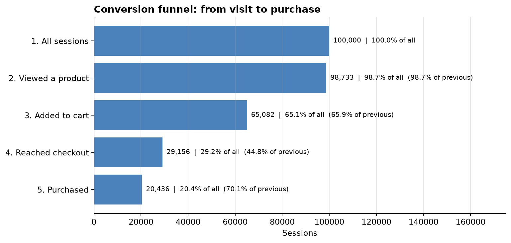
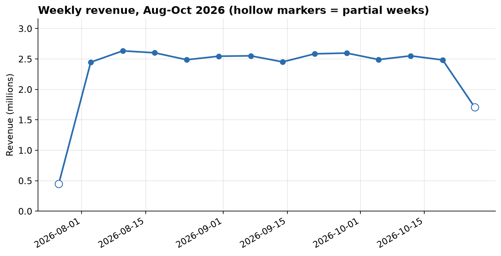
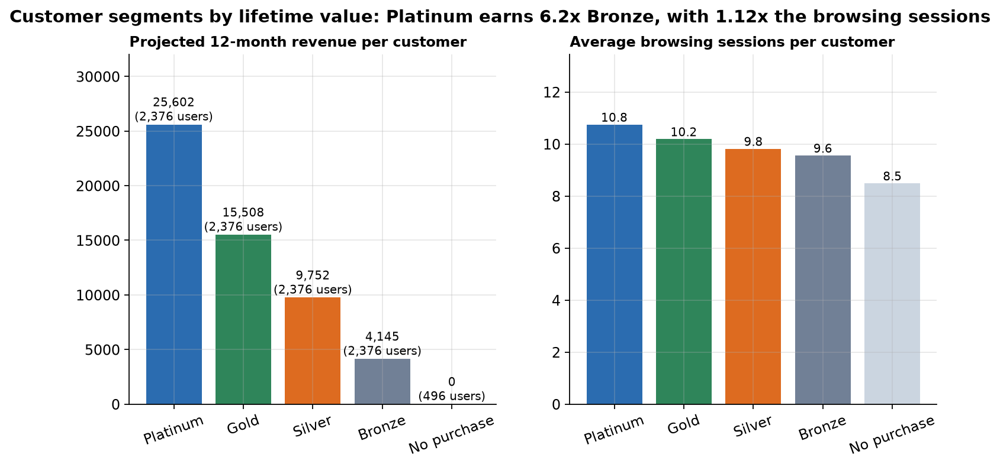
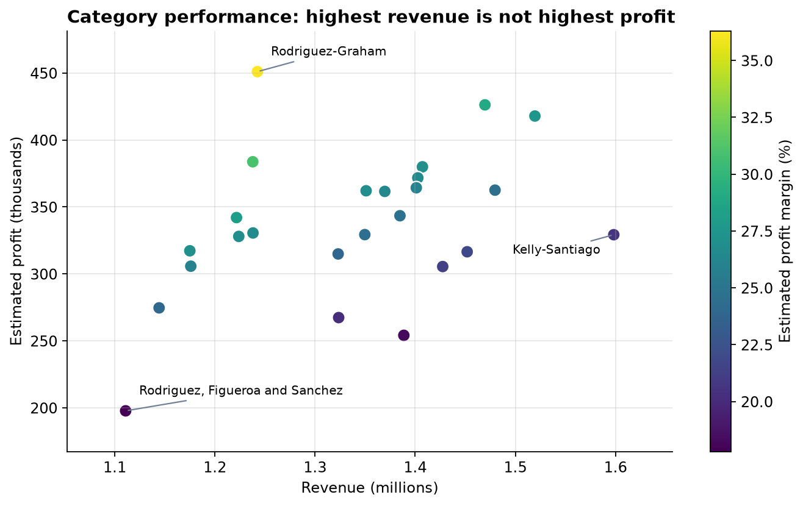
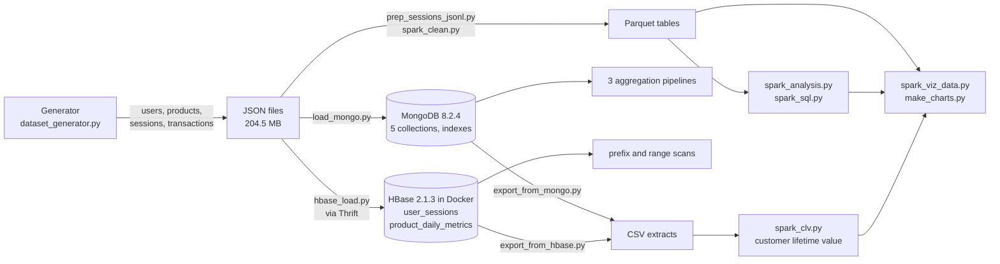

<h1 align="center">Distributed Multi-Model Analytics for E-commerce Data</h1>

<p align="center">
Document and wide-column data models, batch processing, Spark SQL, an integrated customer lifetime value analysis,<br>
visualisation and recommendations for 100,000 sessions and 30,000 transactions, built with MongoDB, HBase and Apache Spark.
</p>

<p align="center">
  
  
  
  
  
  
  
</p>

**Course:** Big Data Analytics, Adventist University of Central Africa (AUCA)<br>
**Project:** Final project, individual (issued 28 October 2026, due 11 November 2026, 11:59 am)<br>
**Student:** Erneste UWIMPUHWE, ID 101414<br>
**Repository:** `https://github.com/erneste-uwimpuhwe/101414_BDA_FINAL_EXAM_PROJECT_SUBMISSION`

---

## Table of contents

1. [Overview](#1-overview)
2. [Key results](#2-key-results)
3. [Architecture](#3-architecture)
4. [Repository structure](#4-repository-structure)
5. [Prerequisites](#5-prerequisites)
6. [Installation and configuration](#6-installation-and-configuration)
7. [Quick start: the connection test](#7-quick-start-the-connection-test)
8. [Full execution guide](#8-full-execution-guide)
9. [Resource protocol](#9-resource-protocol)
10. [Customer lifetime value method](#10-customer-lifetime-value-method)
11. [Regenerating the dataset](#11-regenerating-the-dataset)
12. [Script reference](#12-script-reference)
13. [Data model](#13-data-model)
14. [Analytical queries](#14-analytical-queries)
15. [Verification checklist](#15-verification-checklist)
16. [Troubleshooting](#16-troubleshooting)
17. [Security and secrets](#17-security-and-secrets)
18. [Deliverables](#18-deliverables)
19. [Author](#19-author)
20. [Academic integrity](#20-academic-integrity)

---

## 1. Overview

An online shop wants its analysts to understand how customers browse, buy and are worth over time, and to choose the right data technology for each question. The supplied generator `dataset_generator.py` yields **10,000 users, 5,000 products, 25 categories, 100,000 sessions and 30,000 transactions** over about 90 days (August to October 2026). The supplied file is a Colab notebook export; its code cell was extracted, the generation logic is unchanged, and only the target volumes were set so that the project runs on an 8 GB laptop.

The same data is stored in **MongoDB** (document model) and **HBase** (wide-column model), processed with **Apache Spark**, and combined in one customer lifetime value (CLV) analysis.

The project answers five questions:

| # | Question | Report sections |
|---|---|---|
| 1 | How should products, users, transactions and sessions be modelled in MongoDB, and the session time series in HBase? | 2, 3 |
| 2 | Can Spark clean the data, find products viewed or bought together, and describe cohorts and aggregates in SQL? | 4 |
| 3 | Which customers are the most valuable, and does browsing engagement help to identify them? | 5 |
| 4 | What do the funnel, sales, category and customer charts show, and what should the business do? | 6 |
| 5 | How does the design scale, why was each technology chosen, and what are its limits? | 7, 8 |

---

## 2. Key results

All numbers below are produced by the programs in this repository and are documented, with screenshots, in the report.

| Area | Result |
|---|---|
| Dataset | 10,000 users, 5,000 products, 25 categories, 100,000 sessions, 30,000 transactions; 204.5 MB of JSON |
| MongoDB load | 5 collections and 5 indexes; 100,000 sessions streamed in batches of 5,000 |
| MongoDB top seller | `prod_01476`, 61 units over 26 orders (22,623.07 revenue); the top ten lie between 55 and 61 units |
| MongoDB revenue by category | Kelly-Santiago has the highest revenue (1,598,265.70) but 329,242.73 estimated profit; Rodriguez-Graham has 1,242,448.47 revenue and the highest profit (451,008.79) |
| MongoDB segmentation | 496 no purchase, 3,730 occasional, 4,962 regular, 812 loyal users; regular buyers produce about 62% of total spend |
| HBase | 100,000 session rows and 255,199 product-day rows; newest-first prefix scan of one user's sessions |
| Spark cleaning | 5 tables typed, de-duplicated and validated; 0 rows rejected; 0 transactions with inconsistent totals |
| Products viewed or bought together | pairs co-occur only 2 to 4 times; lift (57 to 111 viewed, 476 to 750 bought) is inflated by rare products |
| Cohorts | 60% to 66% of every full cohort buys in any month; no decay with cohort age |
| Spark SQL | about 10,000 orders per month, average order 1,085; it takes 12 of 25 categories to reach half of revenue; conversion 19.2% to 21.3% in all 15 channel and device groups |
| Cross-engine check | category revenue and top-product units are identical in MongoDB and Spark; the embedded `purchase_summary` matches the pipeline for every user (0 mismatches) |
| Funnel | 100,000 sessions, 98,733 product views, 65,082 carts, 29,156 checkouts, 20,436 purchases (20.4%); the largest loss is cart to checkout (44.8% continue) |
| CLV | Platinum 25,602 against Bronze 4,145 projected 12-month revenue (6.2 times) with 1.12 times the browsing sessions; 76 high-engagement users have never bought |
| Recommendation | MongoDB for documents and aggregation, HBase for key-ordered session scans, Spark for cleaning, SQL and the join across systems |

<table>
  <tr>
    <td align="center"><br><sub>Conversion funnel</sub></td>
    <td align="center"><br><sub>Weekly revenue</sub></td>
  </tr>
  <tr>
    <td align="center"><br><sub>Customer value tiers</sub></td>
    <td align="center"><br><sub>Category revenue against estimated profit</sub></td>
  </tr>
</table>

---

## 3. Architecture



**Components**

| Component | Role |
|---|---|
| MongoDB 8.2.4 (own instance on port 27018, data on drive D:) | Document model: `products` (category embedded), `users` (purchase summary embedded), `transactions` (items embedded), `sessions` (page views nested), `categories` |
| HBase 2.1.3 (Docker image `harisekhon/hbase:2.1`) | Wide-column model: `user_sessions` (row key `user_id#reversed timestamp`) and `product_daily_metrics` (row key `product_id#yyyymmdd`) |
| Apache Spark 4.2.0 (local mode, 2 cores) | Cleaning to Parquet, product pairs, cohorts, Spark SQL, the cross-system join and chart data |
| Java 17 (Temurin 17.0.20) | Runtime for Spark |
| Python 3.13.6 and a virtual environment | All programs (`pymongo` 4.19.0, `happybase` 1.3.0, `pyspark` 4.2.0, `ijson`, pandas, matplotlib) |

---

## 4. Repository structure

```
.
├── README.md                      this file
├── requirements.txt               Python packages
├── .gitignore                     excludes venv/, generated data, Parquet tables and database files
├── data_generation/
│   └── dataset_generator.py       supplied generator (code cell extracted; 100,000 sessions, 30,000 transactions)
├── mongodb/
│   ├── load_mongo.py              loads the five collections and creates indexes
│   └── mongo_aggregations.py      the three aggregation pipelines
├── hbase/
│   ├── create_tables.hbase        creates the two tables and their column families
│   ├── hbase_load.py              loads sessions and daily product metrics through Thrift
│   ├── hbase_queries.py           prefix scan, range scan, count and daily metrics
│   └── hbase_shell_queries.hbase  the same reads in the HBase shell
├── spark/
│   ├── prep_sessions_jsonl.py     converts the session JSON array to JSON Lines
│   ├── spark_clean.py             cleaning and normalisation to Parquet, data-quality report
│   ├── spark_analysis.py          products viewed or bought together, cohorts
│   ├── spark_sql.py               four Spark SQL queries
│   └── spark_viz_data.py          funnel and product views against sales
├── integration/
│   ├── export_from_mongo.py       user profiles and per-user purchase metrics
│   ├── export_from_hbase.py       per-user session activity
│   └── spark_clv.py               join and customer lifetime value
├── visuals/
│   ├── make_charts.py             generates the charts
│   └── charts/                    the generated PNG charts
├── results/                       CSV output of every analysis
├── screenshots/                   every screenshot used in the report
├── docs/                          the technical report (PDF)
└── (local only, NOT in the repository)   JSON data, Parquet tables, MongoDB data files, CSV extracts, venv
```

---

## 5. Prerequisites

| Requirement | Details |
|---|---|
| Operating system | Windows 11. Commands in this guide are for **Command Prompt** |
| Python | 3.13 with `venv` and `pip` |
| Java | 17 (Temurin). Other Java versions may be installed, but `env.bat` selects 17 for this project |
| Apache Spark | 4.2.0 unpacked to `C:\spark` (`SPARK_HOME`), and `winutils.exe` with `hadoop.dll` in `C:\hadoop\bin` (`HADOOP_HOME`) |
| MongoDB | 8.2 Community, for example `D:\MongoDB\Server\8.2\bin\mongod.exe` |
| Docker Desktop | With WSL 2, to run HBase |
| Disk space | About 10 GB free (JSON, Parquet, MongoDB data and the HBase image) |
| Memory | 8 GB RAM was used. Run **one heavy tool at a time** (section 9) |

---

## 6. Installation and configuration

### 6.1 Get the code

The scripts expect the working folder `D:\BDA_Project`. The repository folders map to it as follows: `data_generation` to `data`, `mongodb` to `mongo`, and the other folders keep their names.

```
git clone https://github.com/erneste-uwimpuhwe/101414_BDA_FINAL_EXAM_PROJECT_SUBMISSION D:\BDA_Repo
mkdir D:\BDA_Project
cd /d D:\BDA_Project
mkdir data mongo mongo\data hbase spark integration visuals screenshots
copy D:\BDA_Repo\data_generation\dataset_generator.py data\
copy D:\BDA_Repo\mongodb\*.py mongo\
copy D:\BDA_Repo\hbase\* hbase\
copy D:\BDA_Repo\spark\*.py spark\
copy D:\BDA_Repo\integration\*.py integration\
copy D:\BDA_Repo\visuals\make_charts.py visuals\
```

### 6.2 Python environment

```
python -m venv venv
venv\Scripts\activate
pip install -r D:\BDA_Repo\requirements.txt
```

### 6.3 Environment script (no passwords)

No database password is used. Create `env.bat` in `D:\BDA_Project` and run it at the start of **every new Command Prompt window**, because Windows does not keep these settings between windows:

```
@echo off
set "JAVA_HOME=C:\Program Files\Eclipse Adoptium\jdk-17.0.20.8-hotspot"
set "PATH=%JAVA_HOME%\bin;%PATH%"
set "SPARK_HOME=C:\spark"
set "HADOOP_HOME=C:\hadoop"
set "PATH=%SPARK_HOME%\bin;%HADOOP_HOME%\bin;%PATH%"
if exist D:\BDA_Project\venv\Scripts\activate.bat call D:\BDA_Project\venv\Scripts\activate.bat
cd /d D:\BDA_Project
```

Adjust the Java folder to your installation. Most scripts take the working folder from the environment variable `BDA_BASE` (default `D:\BDA_Project`); the MongoDB and HBase loaders use `D:\BDA_Project\data` directly.

### 6.3.1 Settings used

| Setting | Value |
|---|---|
| MongoDB | port 27018, bind address 127.0.0.1, WiredTiger cache 0.5 GB, data path `D:\BDA_Project\mongo\data` |
| HBase container | memory limit 1.8 GB; ports 2181 (ZooKeeper), 9090 (Thrift) and 16010 (web interface); `D:\BDA_Project\hbase` mounted as `/work` |
| Docker and WSL | WSL memory capped at 3 GB (section 6.4) |
| Spark | local mode with 2 cores, 2 GB driver memory, 8 shuffle partitions, session time zone UTC |

### 6.4 Limit Docker memory (once)

Create `%USERPROFILE%\.wslconfig` with this content, then restart WSL with `wsl --shutdown`:

```
[wsl2]
memory=3GB
processors=2
swap=2GB
```

---

## 7. Quick start: the connection test

Start each service you need and check it. Run the three checks one service at a time:

```
D:\BDA_Project\env.bat
python -c "from pymongo import MongoClient; c=MongoClient('mongodb://127.0.0.1:27018'); print('MongoDB', c.server_info()['version'])"
python -c "import happybase; print(happybase.Connection('127.0.0.1', port=9090).tables())"
python -c "from pyspark.sql import SparkSession; s=SparkSession.builder.master('local[2]').getOrCreate(); print('Spark', s.version); s.range(5).show(); s.stop()"
```

Expected: `MongoDB 8.2.4`, the two HBase table names once the tables exist, and `Spark 4.2.0` with the numbers 0 to 4.

---

## 8. Full execution guide

Run every step from `D:\BDA_Project` in a window prepared as in section 6.3. Steps depend on the earlier ones. Timings were measured on the project laptop (8,035 MB RAM) and are indicative.

| Step | Command | Purpose | Report |
|---|---|---|---|
| 1 | `cd data`, then `python dataset_generator.py` | Generate the five groups of JSON files (about 205 MB, a few minutes) | 1.2 |
| 2 | `"D:\MongoDB\Server\8.2\bin\mongod.exe" --dbpath D:\BDA_Project\mongo\data --port 27018 --bind_ip 127.0.0.1 --wiredTigerCacheSizeGB 0.5` | Start MongoDB in its own window and leave it open | 2.2 |
| 3 | `python mongo\load_mongo.py` | Load categories, products, transactions, users and sessions; create the indexes | 2.2 |
| 4 | `python mongo\mongo_aggregations.py` | Run the three aggregation pipelines and save their CSV files | 2.3 |
| 5 | `docker pull harisekhon/hbase:2.1`, then `docker run -d --name hbase --memory 1800m -p 2181:2181 -p 9090:9090 -p 16010:16010 -v D:\BDA_Project\hbase:/work harisekhon/hbase:2.1` | Start HBase in Docker; wait about 90 seconds | 3.1 |
| 6 | `docker exec hbase hbase shell /work/create_tables.hbase` | Create `user_sessions` and `product_daily_metrics` | 3.2 |
| 7 | `python hbase\hbase_load.py` | Load 100,000 session rows and the product-day metrics (about 5 minutes) | 3.3 |
| 8 | `python hbase\hbase_queries.py` and `docker exec hbase hbase shell /work/hbase_shell_queries.hbase` | Prefix scan, range scan, count and daily metrics | 3.3 |
| 9 | Stop `mongod` (Ctrl+C), `docker stop hbase`, `wsl --shutdown`, quit Docker Desktop | Free memory for Spark | 9 |
| 10 | `python spark\prep_sessions_jsonl.py` | Convert the session JSON array to JSON Lines | 4.1 |
| 11 | `python spark\spark_clean.py` | Clean and normalise to Parquet; print the data-quality report | 4.1 |
| 12 | `python spark\spark_analysis.py` | Products viewed or bought together; cohort analysis | 4.2 |
| 13 | `python spark\spark_sql.py` | Four Spark SQL queries | 4.3 |
| 14 | Start `mongod` (step 2), then `python integration\export_from_mongo.py` | Extract user profiles and per-user purchase metrics from MongoDB | 5.1 |
| 15 | Stop `mongod`; start Docker Desktop, `docker start hbase`, wait about 90 seconds, then `python integration\export_from_hbase.py` | Extract and roll up the 100,000 sessions per user | 5.2 |
| 16 | `docker stop hbase`, quit Docker Desktop, then `python integration\spark_clv.py` | Join the extracts in Spark and compute CLV tiers | 5.3 |
| 17 | `python spark\spark_viz_data.py` | Funnel table and product views against units sold | 6.1 |
| 18 | `python visuals\make_charts.py` | Generate the charts in `visuals` | 6.2 |

### 8.1 Notes

* Run **one heavy tool at a time**: MongoDB, HBase in Docker and Spark were never running together.
* `docker start hbase` keeps the loaded data. Do **not** run `docker rm hbase`, which deletes it.
* The first and last weeks and months of the data are partial, which affects growth percentages.

---

## 9. Resource protocol

The project ran on a laptop with 8,035 MB of RAM, so these rules were followed for every run:

1. One heavy tool at a time. Before Spark: stop `mongod`, run `docker stop hbase` and `wsl --shutdown`, quit Docker Desktop and close the browser.
2. Fixed settings: MongoDB cache 0.5 GB; HBase container 1.8 GB; WSL 3 GB; Spark local mode with 2 cores and 2 GB driver memory.
3. Spark reads the sessions as JSON Lines, so they are split across tasks instead of being loaded in one; the cart is declared as a map in an explicit schema instead of being inferred as 5,000 columns.
4. Data volumes were chosen to fit: 100,000 sessions and 30,000 transactions.
5. The integrated query extracts from each store in turn and joins the CSV extracts in Spark, because the three systems cannot run together in 8 GB.

---

## 10. Customer lifetime value method

* **Sources.** MongoDB gives net revenue, estimated profit, order count and first and last purchase per user (a four-stage aggregation: `$unwind` items, `$lookup` for the category margin, group by transaction, group by user). HBase gives sessions, total duration, page views and converted sessions per user (a scan of four columns from two families).
* **Join.** Left joins on `user_id` keep users who never bought.
* **Projection.** Projected 12-month revenue = revenue in the observed window multiplied by 365 / window days (a window of 91 days gives a factor of 4.01). Projected profit uses the category margin embedded in each product.
* **Tiers.** Buyers are split into quartiles by projected revenue: Platinum, Gold, Silver and Bronze. Users with no order form a fifth group.
* **Engagement.** Pearson correlations with projected revenue are computed over buyers; high-engagement non-buyers are users with no order and at least the 75th-percentile number of sessions.
* **Validation.** The embedded `purchase_summary` in MongoDB must equal the pipeline revenue for every buyer (0 mismatches).

---

## 11. Regenerating the dataset

The generated JSON files (about 205 MB) and the Parquet tables are kept **local** and are not stored in the repository. To recreate the JSON files:

```
cd /d D:\BDA_Project\data
python dataset_generator.py
```

| Entity | Count |
|---|---|
| categories | 25 (3 to 5 subcategories each) |
| products | 5,000 |
| users | 10,000 |
| sessions | 100,000 |
| transactions | 30,000 |

The generator uses fixed random seeds, so the counts and the structure reproduce. Timestamps are generated relative to the run date and identifiers use `uuid`, so individual dates and ids differ between runs; aggregate results can differ slightly.

---

## 12. Script reference

Descriptions are summaries; each script starts with a short comment that describes it.

| Program | Purpose | Output |
|---|---|---|
| `data_generation/dataset_generator.py` | Generate categories, products, users, sessions and transactions | JSON files in the current folder |
| `mongodb/load_mongo.py` | Load the five collections, embed category and purchase summary, create indexes | MongoDB database `ecommerce` |
| `mongodb/mongo_aggregations.py` | Top products, revenue and profit by category, segmentation by purchase frequency | `mongo_top_products.csv`, `mongo_category_revenue.csv`, `mongo_user_segments.csv` |
| `hbase/create_tables.hbase` | Create the two tables with their column families | HBase tables |
| `hbase/hbase_load.py` | Load session rows and per-product daily metrics through Thrift | HBase data |
| `hbase/hbase_queries.py` | Prefix scan, October range scan, count and product daily metrics | printed results |
| `hbase/hbase_shell_queries.hbase` | Shell scans and a `get` | printed results |
| `spark/prep_sessions_jsonl.py` | Convert the session array to JSON Lines | `data\sessions.jsonl` |
| `spark/spark_clean.py` | Clean, normalise and flatten; data-quality report | Parquet tables in `spark\clean` |
| `spark/spark_analysis.py` | Product pairs with confidence and lift; cohort analysis | `spark_viewed_together.csv`, `spark_bought_together.csv`, `spark_cohort.csv` |
| `spark/spark_sql.py` | Four Spark SQL queries | `sql_monthly_revenue.csv`, `sql_category_pareto.csv`, `sql_conversion_by_channel.csv`, `sql_weekly_revenue.csv` |
| `spark/spark_viz_data.py` | Conversion funnel; product views against units sold | `funnel.csv`, `product_views_vs_sales.csv` |
| `integration/export_from_mongo.py` | Extract user profiles and purchase metrics | `integration\mongo_users.csv`, `integration\mongo_txn_metrics.csv` |
| `integration/export_from_hbase.py` | Extract and roll up session activity per user | `integration\hbase_session_metrics.csv` |
| `integration/spark_clv.py` | Join the extracts, estimate CLV, tiers and correlations | `clv_by_user.csv`, `clv_tier_summary.csv` |
| `visuals/make_charts.py` | Funnel, weekly revenue, customer tiers, category, views against sales, cohort heatmap | `chart1` to `chart6` PNG files |

---

## 13. Data model

**MongoDB (database `ecommerce`)**

| Collection | Documents | Design |
|---|---|---|
| `products` | 5,000 | `category` embedded (id, name, average profit margin of its subcategories); `price_history` array |
| `users` | 10,000 | profile and `geo_data`; embedded `purchase_summary` (`total_orders`, `total_spent`, `last_purchase`) |
| `transactions` | 30,000 | `items` array embedded (product id, quantity, unit price, subtotal); `session_id` may be null |
| `sessions` | 100,000 | `page_views` array and `cart_contents` nested in one document per session |
| `categories` | 25 | `subcategories` array with profit margins |

Indexes: `transactions.user_id`, `transactions.timestamp`, `transactions.items.product_id`, `sessions` on (`user_id`, `start_time`) and `products.category_id`.

**HBase**

| Table | Row key | Column families | Purpose |
|---|---|---|---|
| `user_sessions` (100,000 rows) | `user_id#(9999999999 - epoch seconds)`, zero-padded | `info`, `device`, `activity` | one user's sessions, newest first |
| `product_daily_metrics` (255,199 rows) | `product_id#yyyymmdd` | `m` (`views`, `cart_adds`, `purchases`) | daily time series per product |

Both tables keep one version per cell. The `user_sessions` rows hold 15 columns: nine in `info` (session id, start and end time, duration, conversion status, referrer, city, state, country), three in `device` and three in `activity`.

**Spark (Parquet tables from `spark_clean.py`)**

`users`, `categories`, `subcategories`, `products`, `price_history`, `transactions`, `transaction_items`, `sessions`, `page_views` and `cart_items`.

---

## 14. Analytical queries

| Query | Technology | Business question |
|---|---|---|
| Pipeline 1 | MongoDB aggregation | Which products sell the most units? |
| Pipeline 2 | MongoDB aggregation | Which categories earn the most revenue and estimated profit? |
| Pipeline 3 | MongoDB aggregation | How do users split by purchase frequency, and how much do they spend? |
| HBase scans | HBase prefix and range scan | What did one user do recently, and how does one product trend by day? |
| Product pairs | Spark self-join | Which products are viewed or bought together? |
| Cohorts | Spark | How do users registered in the same month buy over time? |
| Spark SQL Q1 | Spark SQL (CTE, `LAG`) | What are monthly revenue, average order value and growth? |
| Spark SQL Q2 | Spark SQL (join, window functions) | How concentrated is revenue across categories, and does revenue rank match profit rank? |
| Spark SQL Q3 | Spark SQL (conditional aggregation) | How does conversion differ by traffic source and device? |
| Spark SQL Q4 | Spark SQL (join, `NTILE`) | How do purchases (MongoDB-style) and sessions (HBase-style) combine per customer? |
| Funnel | Spark | Where do sessions drop out between visit and purchase? |
| CLV | MongoDB, HBase and Spark | Which customers are worth the most, and does browsing identify them? |

---

## 15. Verification checklist

After a full run, these values confirm that the results are reproduced:

| Check | Expected |
|---|---|
| Generator | 100,000 sessions and 30,000 transactions, 25 categories, 5,000 products, 10,000 users; about 205 MB of JSON |
| MongoDB counts | categories 25, products 5,000, transactions 30,000, users 10,000, sessions 100,000 |
| Pipeline 1 | top seller `prod_01476` with 61 units over 26 orders |
| Pipeline 3 | users by segment 496, 3,730, 4,962 and 812 |
| HBase | 100,000 `user_sessions` rows; 255,199 `product_daily_metrics` rows; `user_000000` has 7 sessions |
| Spark cleaning | 10,000 / 25 / 5,000 / 30,000 / 100,000 rows with 0 rejected; 0 inconsistent transaction totals |
| Spark SQL Q1 | about 10,000 orders per month, average order value about 1,085 |
| Funnel | 100,000, 98,733, 65,082, 29,156 and 20,436 sessions; overall conversion 20.4% |
| CLV extracts | 10,000 users and 9,504 buyers from MongoDB; 100,000 sessions from HBase |
| CLV job | observation window 91 days (factor 4.01); 0 mismatches against `purchase_summary`; 76 high-engagement non-buyers |
| Stopped services | `docker ps` lists no running container and `mongod` is closed |

Timings vary between machines and runs. Dates and ids depend on the run date, so small differences in aggregate values can appear after regenerating the data.

---

## 16. Troubleshooting

| Symptom | Cause and fix |
|---|---|
| `OpenBLAS error: Memory allocation still failed` | Not enough free memory, usually because HBase and Docker are running. Run `docker stop hbase` and `wsl --shutdown`, quit Docker Desktop, close other programs and run again |
| `DBPathInUse` or `mongod.lock` error | A `mongod` already uses the data folder. Use the running instance, or stop it with Ctrl+C in its window, then start again |
| `failed to connect to the docker API` | Docker Desktop is not running. Start it and wait for "Engine running" |
| HBase connection error right after `docker start hbase` | HBase needs about 90 seconds to start. Check `docker ps`, wait, and retry |
| `python: can't open file` | The file is not in the folder or the prompt is in another folder. Check the path with `dir` and the prompt |
| `ModuleNotFoundError` | The virtual environment is not active. Run `env.bat` or `venv\Scripts\activate`, then `pip install -r requirements.txt` |
| Spark warns that PySpark does not support pandas 3 | Install an older pandas: `pip install "pandas<3"` |
| `PACKAGE_NOT_INSTALLED` for PyArrow | Harmless: Spark falls back to the standard conversion and the CSV files are still written |
| Spark fails to start or reports a Java version error | `JAVA_HOME` points to an older Java. Run `env.bat` so Java 17 is used |
| `FileNotFoundError` for `sessions.jsonl` | Run `spark\prep_sessions_jsonl.py` before `spark_clean.py` |
| `src refspec main does not match any` on `git push` | Nothing was committed, or git ran in the wrong folder. Run `git add .` and `git commit` from the repository folder first |

---

## 17. Security and secrets

* **No password or key is used or stored in this repository.** MongoDB runs without authentication and listens on `127.0.0.1` only. The HBase container publishes ports 2181, 9090 and 16010 on the host: acceptable on a local laboratory machine, but not for production, where authentication, TLS and a private network are required.
* Keep these **out of the repository**: the JSON data, the Parquet tables, the MongoDB data files, the CSV extracts in `integration`, `venv/` and any file that contains a credential.
* After pushing, run `git ls-files` and confirm that none of the items above are listed.

---

## 18. Deliverables

| Deliverable | Where |
|---|---|
| Technical report (PDF), with screenshots, charts and findings | `docs/` (also submitted separately) |
| Screenshots used in the report | `screenshots/` |
| Code: generator, loaders, queries, Spark jobs and integration scripts | `data_generation/`, `mongodb/`, `hbase/`, `spark/`, `integration/`, `visuals/` |
| Result files of every analysis | `results/` |
| Charts | `visuals/charts/` |
| This README | `README.md` |

---

## 19. Author

| Name | Student ID | Responsibility |
|---|---|---|
| Erneste UWIMPUHWE | 101414 | Individual project: design, implementation, analysis and report |

---

## 20. Academic integrity

The supplied dataset generator is the only code provided with the course. Its generation logic is unchanged; only the target volumes were set to 100,000 sessions and 30,000 transactions. All loading, query, Spark, integration and chart code in this repository was run and checked by the author, and the results were cross-checked between MongoDB and Spark.
